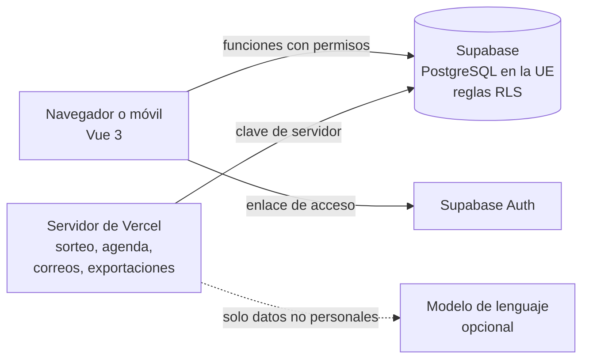
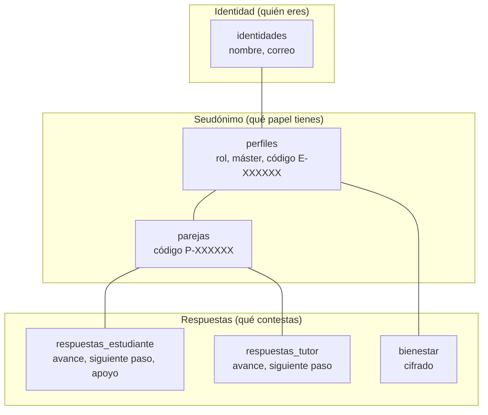
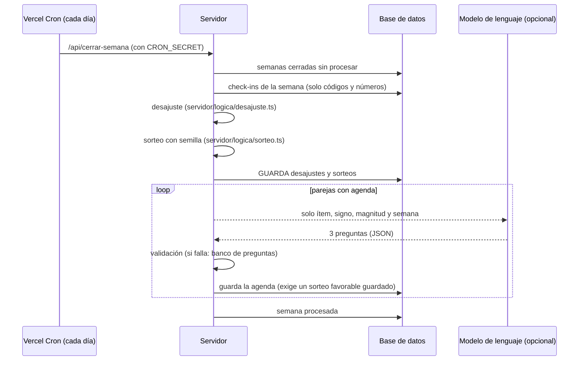

# Arquitectura de SINTONÍA: quién ve qué

Versión de la Fase 6. Se completará en las fases siguientes (sorteo, agenda, panel de dirección y exportación).

Este documento está pensado para el apartado CTS del TFM: cada decisión sobre quién ve qué dato es una decisión de diseño que inclina la herramienta hacia el acompañamiento o hacia la vigilancia.

## 1. Piezas

- **La aplicación (navegador)** nunca lee tablas directamente: llama a funciones de la base de datos, que comprueban quién llama.
- **La base de datos** aplica las reglas de quién ve qué (RLS). Aunque alguien modificara la aplicación, la base de datos seguiría negándose a entregar un dato a quien no le corresponde.
- **El servidor** (fases 4 a 6) hace lo que nunca debe hacer el navegador: el sorteo, la agenda, los correos y las exportaciones.
- **El modelo de lenguaje** (opcional, Fase 4) solo recibe qué ítem no coincide, el signo y la magnitud. Nunca nombres, correos ni textos.

## 2. Datos separados

Las respuestas solo llevan el código de la pareja. El nombre está en otra tabla que solo puede leer su dueño.

## 3. Quién ve qué (aplicado en la base de datos)

| Dato | Estudiante | Tutor/a | Dirección | Investigador |
|---|---|---|---|---|
| Su propia identidad (nombre y correo) | Sí | Sí | Sí | Sí |
| Identidad de otras personas | No | Solo el **nombre** de sus estudiantes, mediante una función que no devuelve correos | No | **No** |
| Perfiles seudónimos | El suyo | El suyo | El suyo | Todos (sin nombres) |
| Parejas | La suya | Las suyas | No | Todas (seudónimas) |
| Respuestas del estudiante | Las suyas | **No** | **No** | Todas (seudónimas) |
| Respuestas del tutor | **No** | Las suyas | **No** | Todas (seudónimas) |
| Bienestar | Solo el suyo | **No** | **No** | **No** en la tabla. Solo dentro de la exportación seudonimizada, que queda registrada (Fase 6) |
| Códigos de acceso | No | Los suyos sin usar, para repartirlos | No | Todos |
| Consentimientos | Los suyos | Los suyos | Los suyos | Todos |
| Avisos de "Necesito apoyo" | Los suyos | **No** | Los de su máster, mediante una función que solo da la fecha y el nombre **si el estudiante lo ha autorizado** | No |
| Desajustes calculados | **No** | **No** | **No** | Sí (seudónimos) |
| Sorteos | **No** | **No** | **No** | Sí (seudónimos) |
| Agenda de la pareja | La suya | La de cada pareja suya | **No** | Sí (seudónimos) |
| Puente al doctorado activado | Sí | Solo la línea de la agenda | No | Sí (seudónimos) |
| Respuestas a los cuestionarios | Las suyas | **No** | **No** | Sí (seudónimos) |
| Correos electrónicos de las personas | El suyo | **No** | **No** | **No** (solo el servidor, para enviar recordatorios) |
| Auditoría | No | No | No | Sí |
| Resúmenes del máster (Fase 6) | No | No | Sí, con un mínimo de 5 personas | Sí |

Nadie, ni siquiera el investigador, puede escribir directamente en ninguna tabla. Todos los cambios pasan por funciones que comprueban las reglas.

Cada fila de esta tabla está comprobada por un test automático (`tests/bd/permisos.test.ts`).

## 4. Cifrado del bienestar

- El valor se guarda cifrado con `pgp_sym_encrypt` (extensión pgcrypto).
- La clave se genera dentro de la base de datos la primera vez y se guarda en el almacén de secretos de Supabase (Vault), no en el código.
- Las funciones que descifran no se pueden llamar desde la aplicación.
- Límite honesto: quien administra el proyecto de Supabase podría, técnicamente, descifrar el dato. El cifrado protege frente a lecturas accidentales, copias de tablas y errores de permisos; la protección frente a la administración es organizativa (acceso restringido al proyecto y registro de auditoría).

## 5. Alta de personas

1. El investigador crea los másteres y genera códigos: de tutor, de dirección y de estudiante (estos últimos ya van asociados a un tutor).
2. Cada persona se registra con su código, su nombre y su correo institucional.
3. Al crearse la cuenta, la base de datos comprueba el código, el dominio del correo y, si es un estudiante, crea la pareja con su tutor.
4. Estudiantes y tutores aceptan el consentimiento informado (versionado) antes de participar.
5. El investigador se autoriza una sola vez desde el panel de Supabase (ver el README).

El investigador nunca necesita conocer nombres: reconoce a los tutores por la etiqueta que puso a su código (por ejemplo, "Tutor 3").

## 6. Check-ins y bienestar bajo

- Cada estudiante responde 4 ítems por semana; el tutor, 1 obligatorio y 1 opcional por estudiante.
- El check-in solo se acepta mientras la semana está abierta. Se puede cambiar hasta el cierre, pero hay una sola respuesta por semana.
- Si el estudiante responde 1 o 2 en bienestar, solo su propia pantalla muestra un mensaje amable y el enlace al servicio de atención psicológica. **No se avisa a nadie y no se guarda ninguna marca.**
- "Necesito apoyo" es lo único que avisa a otra persona, y solo cuando el estudiante lo pulsa.

## 7. Derechos sobre los datos

| Derecho | Cómo se ejerce | Qué ocurre |
|---|---|---|
| Acceso | Mi cuenta > Descargar | Archivo con todo lo que se guarda sobre la persona. Queda en la auditoría. |
| Rectificación | Mi cuenta > Nombre | Cambia el nombre. |
| Retirada | Mi cuenta > Retirarme y conservar | Deja de participar; las respuestas anteriores se conservan sin nombre. |
| Supresión | Mi cuenta > Retirarme y borrar | Se borran la cuenta, la identidad, las respuestas, el bienestar, los avisos y lo que el tutor respondió sobre el estudiante. |

## 8. Cierre de semana: desajuste, sorteo y agenda

- La base de datos **no permite** guardar una agenda sin un sorteo favorable guardado antes (clave foránea y comprobación en la función).
- Ni el estudiante ni el tutor ven la diferencia, el desajuste ni el resultado del sorteo: solo ven las tres preguntas o el mensaje "Esta semana no hay agenda. Sigue como siempre."
- Lo que se envía al modelo queda guardado con la agenda (`entrada_modelo`), para poder comprobar que nunca contiene datos personales.

## 9. Correos

- Los correos son el único momento en que se juntan nombre, correo y actividad, y solo los ve el servidor.
- Recordatorios: uno al abrirse el check-in y otro 48 horas antes del cierre, solo a quien no ha respondido y los tiene activados.
- Aviso de apoyo a la dirección: solo el máster y, si el estudiante lo autorizó, su nombre. Nunca respuestas ni bienestar.

## 10. Panel de la dirección: la regla de las 5 personas

- La base de datos calcula todas las cifras y **suprime** cualquiera calculada sobre menos de 5 personas antes de enviarla. La dirección nunca recibe ese valor: solo la marca "suprimida". Tampoco recibe cuántas personas había, porque eso también sería una cifra sobre pocas personas.
- Cifras y personas sobre las que se calculan:

| Cifra | Personas que cuentan |
|---|---|
| Estudiantes participantes | los estudiantes participantes |
| Tasa de respuesta de estudiantes | los estudiantes participantes |
| Tasa de respuesta de tutores | los tutores con estudiantes |
| Avance medio según los estudiantes | los estudiantes que respondieron |
| Avance medio según los tutores | los tutores que respondieron |
| Desajuste medio | las parejas con las dos respuestas |
| Agendas generadas | las parejas que entraron en el sorteo |

- El mínimo (5) se puede subir en la tabla `configuracion` (`minimo_anonimato`).
- Nunca hay datos por tutor/a, filas individuales ni bienestar, ni siquiera agregado.
- **Límite conocido:** comparando dos semanas en las que el grupo cambia en una sola persona, en teoría se podría deducir algo de esa persona. Con grupos de 30 a 50 parejas y medias redondeadas a dos decimales el riesgo es bajo, pero existe. Una mejora posible es añadir un pequeño ruido aleatorio a las medias (privacidad diferencial).

## 11. Exportación para la investigación

- Solo el investigador puede descargarla, siempre con códigos seudónimos.
- Es el único lugar donde el investigador recibe el bienestar. Cada descarga queda en la auditoría, con el número de filas.
