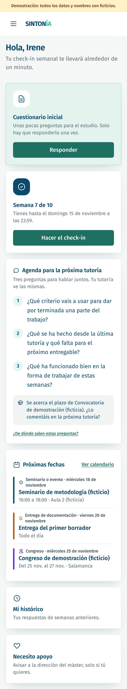
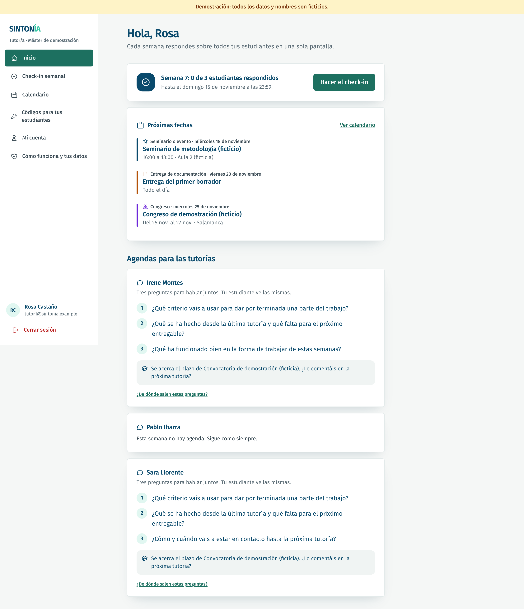
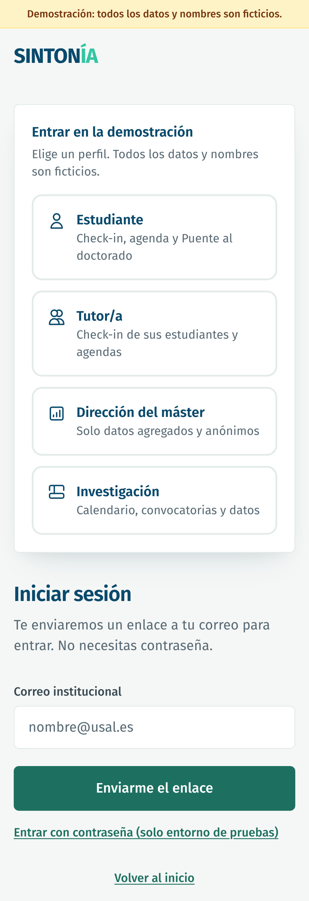

# SINTONÍA

**Acompañar el trabajo académico, sin vigilar.**

SINTONÍA es el prototipo del Trabajo Fin de Máster de Fernando Martín Vaquero (Máster en Estudios de la Ciencia, la Tecnología y la Innovación, Universidad de Salamanca, curso 2026/27), dirigido por el Dr. Luis Eduardo Andrade Silva y la Dra. Ana María Pinto Llorente.

Cada semana, estudiante y tutor/a responden por separado unas pocas preguntas sobre cómo avanza el trabajo. SINTONÍA detecta dónde no coinciden las dos miradas y, algunas semanas (por sorteo, como parte del estudio), propone tres preguntas neutras para la siguiente tutoría.

| Estudiante (móvil) | Tutor/a (escritorio) |
|---|---|
|  |  |

---

## Índice

1. [Qué hay en este repositorio](#1-qué-hay-en-este-repositorio)
2. [Cómo funciona por dentro, en dos minutos](#2-cómo-funciona-por-dentro-en-dos-minutos)
3. [Publicar SINTONÍA paso a paso (Supabase y Vercel)](#3-publicar-sintonía-paso-a-paso)
4. [Primeros pasos una vez publicada](#4-primeros-pasos-una-vez-publicada)
5. [Publicar una demostración con datos ficticios](#5-publicar-una-demostración-con-datos-ficticios)
6. [Cambiar textos y ajustes](#6-cambiar-textos-y-ajustes)
7. [Probarla en tu ordenador](#7-probarla-en-tu-ordenador)
8. [Comprobaciones automáticas (tests)](#8-comprobaciones-automáticas-tests)
9. [Si algo falla](#9-si-algo-falla)

---

## 1. Qué hay en este repositorio

| Documento | Contenido |
|---|---|
| [PLAN.md](PLAN.md) | Tecnología elegida y fases de trabajo |
| [DISENO.md](DISENO.md) | Sistema visual heredado de WORKWELL360 |
| [ARQUITECTURA.md](ARQUITECTURA.md) | Quién ve qué dato y cómo se protege (para el apartado CTS del TFM) |
| [NORMATIVA.md](NORMATIVA.md) | Reglamentos de TFG, TFM y doctorado de la USAL y cómo los refleja SINTONÍA |
| [DATOS.md](DATOS.md) | Diccionario de datos de las exportaciones |
| [DECISIONES.md](DECISIONES.md) | Registro de decisiones |
| [PENDIENTES.md](PENDIENTES.md) | Datos que faltan y no se pueden inventar |
| [VERIFICACION.md](VERIFICACION.md) | Criterios de aceptación y cómo se comprueba cada uno |
| [docs/capturas](docs/capturas) | Capturas de todas las pantallas, en móvil y escritorio, en modo demostración |
| [analisis/analisis_ejemplo.R](analisis/analisis_ejemplo.R) | Script de R de ejemplo (modelo multinivel) |

Y las carpetas de código:

| Carpeta | Qué es |
|---|---|
| `src/` | La aplicación que se ve en el navegador (Vue) |
| `supabase/migrations/` | La base de datos: tablas, permisos y funciones |
| `supabase/instalacion-completa.sql` | Todo lo anterior en un solo archivo, para pegarlo en Supabase |
| `servidor/` | Lo que hace el servidor: desajuste, sorteo, agenda y correos |
| `api/` | Las tareas automáticas que ejecuta Vercel cada día |
| `scripts/` | Utilidades: datos de prueba, demostración, medición de rendimiento |
| `tests/` | Comprobaciones automáticas |
| `.claude/skills/` | Instrucciones para Claude sobre diseño de interfaces y animaciones (de Emil Kowalski, licencia MIT). No forman parte de la aplicación |

---

## 2. Cómo funciona por dentro, en dos minutos

SINTONÍA tiene tres piezas:

1. **Supabase** guarda los datos (en un servidor de la Unión Europea) y gestiona el acceso por enlace al correo. Las reglas de quién ve qué están escritas **en la propia base de datos**: aunque alguien modificara la aplicación, la base de datos seguiría negándose a entregar un dato a quien no le corresponde.
2. **Vercel** publica la aplicación en una dirección web y ejecuta dos tareas automáticas cada día:
   - a las 00:15 (hora de Madrid en invierno), cierra las semanas terminadas: calcula el desajuste, hace el sorteo y prepara las agendas;
   - a las 08:15, envía los recordatorios y los avisos de apoyo pendientes.
3. **Resend** (u otro proveedor) envía los correos.

Opcionalmente, un **modelo de lenguaje** (Claude, de Anthropic) puede redactar las preguntas de la agenda. Sin él, se usan preguntas escritas de antemano y todo funciona igual.

Todo esto tiene planes gratuitos suficientes para el piloto (30 a 50 parejas).

---

## 3. Publicar SINTONÍA paso a paso

Tardarás alrededor de una hora la primera vez. No hace falta saber programar: solo copiar y pegar con cuidado. Los nombres exactos de los menús de Supabase y Vercel pueden cambiar un poco con el tiempo.

### 3.1. Antes de empezar

Necesitas cuentas gratuitas en:

- **GitHub**, donde ya está este repositorio.
- **Supabase**: https://supabase.com (puedes entrar con tu cuenta de GitHub).
- **Vercel**: https://vercel.com (también con GitHub).
- **Resend**, para los correos: https://resend.com. Hace falta un dominio desde el que enviar (ver [PENDIENTES.md](PENDIENTES.md)).

Ten a mano un lugar seguro para apuntar claves (por ejemplo, un gestor de contraseñas). **Nunca las pegues en GitHub.**

### 3.2. Crear la base de datos en Supabase

1. En Supabase, pulsa **New project**.
2. Ponle un nombre (por ejemplo, `sintonia`) y una contraseña de base de datos larga. Apúntala.
3. En **Region**, elige una de la Unión Europea, por ejemplo **Central EU (Frankfurt)**. Esto es importante para el RGPD.
4. Espera a que el proyecto esté listo (un par de minutos).
5. En el menú de la izquierda, abre **SQL Editor** y pulsa **New query**.
6. Abre en GitHub el archivo [`supabase/instalacion-completa.sql`](supabase/instalacion-completa.sql), pulsa el botón de copiar el contenido, pégalo entero en el editor y pulsa **Run**. Debe terminar sin errores. Hazlo **una sola vez**.

Con eso se crean todas las tablas, las reglas de permisos, las funciones y la clave de cifrado del bienestar (que se genera sola y se guarda en el almacén de secretos de Supabase).

### 3.3. Configurar el acceso por correo en Supabase

1. **Authentication > URL Configuration**:
   - **Site URL**: la dirección que te dará Vercel en el paso 3.5 (por ejemplo, `https://sintonia.vercel.app`). Puedes volver a cambiarla después.
   - **Redirect URLs**: añade la misma dirección seguida de `/**`.
2. **Authentication > Emails > Templates**. SINTONÍA abre los enlaces en su propia página, así que hay que cambiar el enlace de dos plantillas:
   - En **Magic Link**, sustituye el enlace por:
     ```
     {{ .SiteURL }}/acceso/confirmar?token_hash={{ .TokenHash }}&type=email
     ```
   - En **Confirm signup**, pon exactamente el mismo enlace.

   Puedes cambiar también el texto de los correos (en español, sin presión).
3. **Authentication > Providers > Email**: pon **Email OTP Expiration** en `900` (15 minutos). Así el enlace de acceso dura poco; además, solo sirve una vez.
4. **Authentication > Emails > SMTP Settings**: activa un servidor de correo propio. El correo que trae Supabase de serie solo envía unos pocos mensajes por hora y no sirve para el piloto. Con Resend:
   - Host `smtp.resend.com`, puerto `465`, usuario `resend`, contraseña: tu clave de API de Resend.
   - Remitente: la dirección de tu dominio verificado en Resend.

### 3.4. Copiar las claves de Supabase

En **Project Settings > API** (o **API Keys**) encontrarás tres cosas. Apúntalas:

| En Supabase | La usarás como | ¿Secreta? |
|---|---|---|
| Project URL | `VITE_SUPABASE_URL` y `SUPABASE_URL` | No |
| `anon` / `publishable` key | `VITE_SUPABASE_ANON_KEY` | No (los permisos los decide la base de datos) |
| `service_role` / `secret` key | `SUPABASE_SERVICE_ROLE_KEY` | **Sí, mucho**: solo para Vercel |

### 3.5. Publicar la aplicación en Vercel

1. En Vercel, pulsa **Add New > Project** e importa el repositorio **SINTONIA** de GitHub.
2. Vercel detecta que es un proyecto **Vite**. No cambies nada de la compilación.
3. Abre **Environment Variables** y añade estas (copia los nombres tal cual; tienes la lista comentada en [`.env.example`](.env.example)):

   | Variable | Valor |
   |---|---|
   | `VITE_SUPABASE_URL` | Project URL de Supabase |
   | `VITE_SUPABASE_ANON_KEY` | clave `anon` / `publishable` |
   | `SUPABASE_URL` | Project URL de Supabase (otra vez) |
   | `SUPABASE_SERVICE_ROLE_KEY` | clave `service_role` / `secret` |
   | `CRON_SECRET` | una cadena larga al azar (por ejemplo, de un generador de contraseñas, 40 caracteres) |
   | `APP_URL` | la dirección de la aplicación, por ejemplo `https://sintonia.vercel.app` |
   | `CORREO_PROVEEDOR` | `resend` |
   | `RESEND_API_KEY` | tu clave de API de Resend |
   | `CORREO_REMITENTE` | por ejemplo `SINTONÍA <sintonia@tu-dominio.es>` |
   | `AGENDA_MODO` | `banco` (o `modelo`, ver 3.7) |
   | `CORREO_CONTACTO` | dirección que recibe el formulario de contacto (por defecto, `ferca@usal.es`) |

4. Pulsa **Deploy**. Al terminar, Vercel te da la dirección pública. Si es distinta de la que pusiste en `APP_URL` o en Supabase (3.3), corrígela en los dos sitios y vuelve a desplegar (**Deployments > Redeploy**).

Las tareas automáticas diarias se activan solas (están en `vercel.json`), y las funciones se ejecutan en Fráncfort, dentro de la UE. Puedes verlas en **Settings > Cron Jobs**.

### 3.6. Comprobar que todo funciona

Abre la dirección de la aplicación. Debes ver la página de inicio sin ninguna franja amarilla (la franja solo aparece en la demostración y en el entorno local). Sigue con el apartado 4.

### 3.7. (Opcional) Redacción de la agenda con un modelo de lenguaje

1. Crea una clave en https://console.anthropic.com.
2. En Vercel, añade `ANTHROPIC_API_KEY` con esa clave y cambia `AGENDA_MODO` a `modelo`.
3. Opcionalmente, `AGENDA_MODELO` para elegir el modelo (por defecto, `claude-opus-5-5`).

El modelo solo recibe qué pregunta no coincide, en qué sentido, por cuánto y la semana del estudio. Nunca nombres ni correos. Si falla o su respuesta no supera la validación, se usa el banco de preguntas.

---

## 4. Primeros pasos una vez publicada

### 4.1. Darte de alta como investigador

1. En Supabase, **SQL Editor > New query**, pega esto con tu correo y pulsa **Run**:
   ```sql
   insert into private.investigadores_autorizados (email) values ('tu-correo@usal.es');
   ```
2. En **Authentication > Users > Add user > Create new user**, escribe tu correo, una contraseña cualquiera y marca **Auto Confirm User**.
3. En la aplicación, **Iniciar sesión** con tu correo: te llegará el enlace.

Como investigador **no verás ningún nombre**: tutores y estudiantes aparecen con códigos (y los tutores, con la etiqueta que tú pongas a su código).

### 4.2. Preparar el estudio

En el menú **Investigación** (panel en `/investigador`):

1. **Calendario del estudio**: fecha de inicio de la semana 1, duración (10 semanas) y días de apertura y cierre. Mientras no pongas la fecha, el estudio "no ha empezado".
2. **Másteres y códigos**: crea los dos másteres y genera:
   - un código por cada persona de **dirección** y cada **tutor/a** (con una etiqueta, por ejemplo "Tutor 3", nunca un nombre). Por defecto, cada código sirve para una persona y caduca a los 30 días; puedes cambiarlo al crearlo y anular un código desde la lista;
   - cuando los tutores se hayan registrado, los **códigos de pareja** para sus estudiantes (cada tutor/a los ve también en su panel para repartirlos).
3. **Parejas y tutores**: refleja las decisiones de la comisión académica, como un cambio de tutor/a o una cotutoría (hasta dos cotutores además del principal). Cada cotutor hace su propio check-in y ve la misma agenda.
4. **Eventos del máster** (opcional): publica congresos, seminarios o plazos que verán todos los estudiantes y tutores de ese máster. La dirección del máster puede hacerlo también desde su menú ("Calendario del máster").
5. **Convocatorias**: rellena las fechas, el organismo, el enlace oficial y el estado de cada convocatoria de Puente al doctorado.
6. Revisa [PENDIENTES.md](PENDIENTES.md): consentimiento, política de privacidad, enlace del servicio de atención psicológica, ítems de los cuestionarios... (ver el apartado 6).

### 4.3. Durante el piloto

- **Datos y auditoría**: descarga los CSV (semanal, pretest y postest). Cada descarga queda registrada. Las variables están en [DATOS.md](DATOS.md).
- **Calendario del estudio** muestra, semana a semana, cuántas parejas entraron en el sorteo y cuántas recibieron agenda.
- Estudiantes y tutores tienen un **Calendario** en su menú para anotar tutorías, entregas, congresos y otras fechas, y deciden si lo ve solo quien lo anota o también la otra parte de la pareja. Las próximas fechas salen en su pantalla de inicio. El calendario no forma parte de los datos del estudio: no se exporta.
- Para analizar: abre el CSV semanal con [analisis/analisis_ejemplo.R](analisis/analisis_ejemplo.R) en RStudio.

---

## 5. Publicar una demostración con datos ficticios

Para enseñar SINTONÍA a tus directores, a TCUE o a empresas sin datos reales. La demostración tiene 1 máster, 4 tutores, 12 estudiantes y 6 semanas simuladas, y una franja amarilla que dice "Demostración". En la página de acceso aparecen cuatro botones para entrar como estudiante, tutor/a, dirección o investigación (contraseña pública: `demo-sintonia`).



**La demostración nunca se mezcla con los datos reales:**

- usa **otro proyecto de Supabase** y **otro proyecto de Vercel**;
- la base de datos queda marcada como "demostración", y la aplicación muestra siempre el aviso si la base de datos lo es;
- el generador se niega a crear la demostración en una base de datos con personas registradas;
- solo admite correos del dominio inventado `sintonia.example`.

Pasos:

1. Crea un **segundo proyecto** en Supabase (por ejemplo, `sintonia-demo`, también en la UE) y repite los pasos 3.2 a 3.4.
2. En tu ordenador (ver el apartado 7 para instalar lo necesario), con estas tres variables del proyecto de demostración:
   ```bash
   DEMO_DATABASE_URL="cadena de conexión (Project Settings > Database > Connection string)" DEMO_SUPABASE_URL="Project URL" DEMO_SUPABASE_SERVICE_ROLE_KEY="clave service_role" npm run demo:remoto
   ```
3. Crea un **segundo proyecto** en Vercel con el mismo repositorio y las variables del proyecto de demostración, más:
   - `VITE_MODO_DEMO` = `true`
   - `CORREO_PROVEEDOR` = `ninguno` (la demostración no envía correos)

Las semanas simuladas se calculan desde el día en que se genera la demostración. Para "rejuvenecerla" más adelante, repite el paso 2 añadiendo `-- --reiniciar` al final (solo vacía bases de datos marcadas como demostración).

---

## 6. Cambiar textos y ajustes

La mayoría de los textos se cambian en Supabase, en **Table Editor**, como en una hoja de cálculo. Al guardar, la aplicación los usa al momento.

| Qué | Tabla | Columna |
|---|---|---|
| Preguntas del check-in y palabras de los extremos de la escala | `items` | `texto`, `ancla_min`, `ancla_max` |
| Consentimiento informado | `consentimiento_textos` | añade una fila con la versión siguiente y marca `vigente`; quita la marca a la anterior. Todo el mundo tendrá que aceptarlo de nuevo |
| Enlace del servicio de atención psicológica, política de privacidad, responsable del tratamiento, dominios de correo admitidos, mínimo de anonimato | `configuracion` | `valor` |
| Preguntas y opciones del pretest y del postest | `cuestionario_items` | `texto`, `opciones`, `ancla_min`, `ancla_max` (y `pendiente` = false cuando esté listo) |
| Instrucciones y fechas del pretest y del postest | `cuestionarios` | `instrucciones`, `desde_semana`, `hasta_semana` |
| Banco de preguntas de la agenda | `banco_preguntas` | `texto`, `activo` |
| Enlaces a la normativa del doctorado (pantalla de Puente) | `enlaces_normativa` | `titulo`, `url`, `activo` |
| Tipo de trabajo de cada máster o programa (cambia los textos: en tesis, "director/a" y "doctorando/a") | `masters` | `tipo_trabajo` (`TFG`, `TFM` o `TESIS`) |
| Probabilidad del sorteo (0,5 por defecto) | `estudios` | `probabilidad_agenda` |
| Umbrales del desajuste | `reglas_desajuste` | añade una versión nueva y márcala `vigente` (la anterior queda registrada) |

Los textos marcados como `[PENDIENTE: ...]` aparecen en la aplicación sobre un fondo amarillo, para que nadie los confunda con un texto definitivo.

---

## 7. Probarla en tu ordenador

Necesitas **Node.js 20** o posterior y **PostgreSQL 16** (usuario `postgres`, contraseña `postgres`). Las órdenes se escriben en una terminal, dentro de la carpeta del proyecto.

1. Instala las dependencias:
   ```bash
   npm install
   ```
2. **Opción A: la demostración** (datos ficticios):
   ```bash
   npm run demo:local
   ```
   ```bash
   npm run demo:servidor
   ```
   y, en otra terminal:
   ```bash
   npm run demo:app
   ```
   Abre http://localhost:5173 y usa los botones de acceso rápido.
3. **Opción B: el entorno de desarrollo** (unas pocas cuentas para probar cada pantalla):
   ```bash
   npm run local:db
   ```
   ```bash
   npm run local:servidor
   ```
   y, en otra terminal:
   ```bash
   npm run dev
   ```
   Cuentas (contraseña `sintonia-local`, botón "Entrar con contraseña"): `investigador@usal.es`, `tutora@usal.es`, `tutor8@usal.es` (con 8 estudiantes), `direccion@usal.es` y `ana@usal.es`. Los enlaces de acceso por correo aparecen en la terminal del servidor.

   Para ejecutar a mano las tareas diarias (cierre de semanas, recordatorios y avisos; los correos se muestran en la terminal):
   ```bash
   npm run local:tareas
   ```

En local, Supabase se sustituye por PostgreSQL y un pequeño servidor que imita su funcionamiento (`scripts/local`). Las reglas de la base de datos son exactamente las mismas.

---

## 8. Comprobaciones automáticas (tests)

| Orden | Qué comprueba |
|---|---|
| `npm test` | Lógica (desajuste, sorteo, agenda, Puente, correos), permisos de la base de datos y el script de R |
| `npm run test:e2e` | Recorridos completos en un navegador, en móvil y escritorio, con revisión de accesibilidad |
| `npm run test:demo` | La demostración: accesos rápidos, accesibilidad de todas las pantallas, tamaños táctiles |
| `npm run rendimiento` | Cuánto tarda el check-in en un móvil con conexión lenta |
| `npm run capturas` | Vuelve a hacer todas las capturas de `docs/capturas` |

El resultado de todas ellas está en [VERIFICACION.md](VERIFICACION.md).

---

## 9. Si algo falla

| Síntoma | Causa probable |
|---|---|
| El enlace del correo dice "El enlace ha caducado o ya se ha usado" | La plantilla de correo de Supabase no tiene el enlace del paso 3.3, o la **Site URL** es otra |
| No llegan correos | Falta el servidor SMTP propio (3.3), o el remitente no está verificado en Resend |
| "Usa tu correo institucional" | El dominio no está en `configuracion > dominios_permitidos` (por defecto, solo `usal.es`) |
| No se generan agendas | Comprueba en Vercel **Settings > Cron Jobs** y las variables `SUPABASE_SERVICE_ROLE_KEY` y `CRON_SECRET` |
| La franja amarilla avisa de que "la base de datos es real" | Has puesto `VITE_MODO_DEMO=true` apuntando al proyecto real: quítalo |
| "Falta configurar la clave de cifrado del bienestar" | La instalación del paso 3.2 no terminó: vuelve a ejecutarla en un proyecto nuevo |
